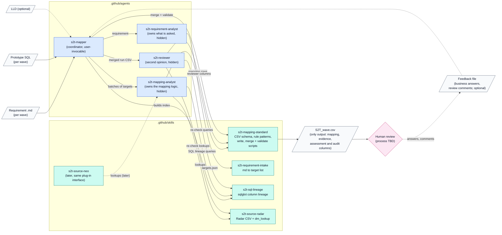

# S2T Generation Agent: Proposed Architecture

## Purpose and status

This document proposes an architecture for an AI solution that auto-generates S2T (source-to-target) mappings using GitHub Copilot in Visual Studio Code. It is a brainstorming proposal: nothing has been built yet.

Scope:

- **S2T mappings only.** Test cases, test SQL, mapping code and governance outputs are out of scope.
- **Radar source only**, with an extension point for Neo later.
- **Inputs per run:** a requirement document for a wave (markdown, structure may change) and prototype SQL (a single query may demonstrate several mappings). Optional: the LLD and a feedback file with business answers and review comments (section 3).
- **Fixed input:** the Radar data model as a CSV of all tables and columns. Table names indicate the environment (STG, DDW or DM).
- **Output:** a single S2T CSV file. It is both the deliverable and the record that people review and audit, so it carries evidence, confidence and audit information as well as the mapping itself (section 4). The CSV columns will be proposed in a separate step.
- **No global instructions**, because the repository is shared across projects.
- **Environment:** Python is available. MCP servers are disabled, so every tool is a Python script that the agents run through the `execute` tool.
- **Legal traceability:** every target attribute mapping traces back to exactly one section identifier (see Terms).

It builds on the process described in [S2T-flow-diagrams.md](S2T-flow-diagrams.md), mainly diagrams 3 (S2T content), 8 (availability and gaps), 9 (S2T generation) and 10 (inputs and knowledge base). It follows the VS Code agent customisation documentation as of November 2026 ([overview](https://code.visualstudio.com/docs/agent-customization/overview), [custom agents](https://code.visualstudio.com/docs/agent-customization/custom-agents), [agent skills](https://code.visualstudio.com/docs/agent-customization/agent-skills), [custom instructions](https://code.visualstudio.com/docs/agent-customization/custom-instructions), [hooks](https://code.visualstudio.com/docs/agent-customization/hooks), [subagents](https://code.visualstudio.com/docs/agents/run/subagents)).

### Terms

The word "section" has several meanings in the S2T material, so this document keeps one term for each.

| Term | Meaning | Example |
| --- | --- | --- |
| **Section identifier** | Identifier of the item in the legal standard that a target attribute implements, as in the flow document. Each target has exactly one, stated in the requirement. It is always recorded with the name of its standard, because standards other than APS 210 may be used in later waves. The agents extract it from the requirement; they never infer it. | APS 210 "20", APS 210 "44.c" |
| **Source system** | System whose data feeds a target and may need its own source or logic. Diagram 9 of the flow document calls the part of the S2T for one source system a "section" (step "AIA sets up a section per source system"); this document says source system. | BANCS, CTD, super TD |
| **Section *n*** | A numbered section of this document. | Section 2.1 |

## 1. Design principles

| # | Principle | Why |
| --- | --- | --- |
| P1 | **No global instructions.** No `.github/copilot-instructions.md`, no root `AGENTS.md`, no `applyTo: '**'`. | The repository is shared across projects. All S2T guidance loads only when the S2T agent is selected or S2T files are touched. |
| P2 | **Scripts gather evidence; one agent makes the mapping decisions.** | Scripts do the data model lookup, SQL parsing, validation and CSV output, and return facts without deciding anything. The `s2t-mapping-analyst` weighs the requirement, the prototype SQL and the data model together and decides each mapping (section 2.1). The `s2t-requirement-analyst` only records what the requirement asks for, and the coordinator only orchestrates. Instructions and skills guide the model but don't enforce anything. |
| P3 | **A platform-neutral S2T CSV schema with a source-platform plug-in.** | Diagram 10 says the knowledge base should be technology-specific and reusable. Neo then means adding a plug-in, not rewriting the agent. |
| P4 | **Each step gets only the inputs it needs.** | Diagram 10 says giving the agent everything makes the context too large. The data model CSV and the full SQL are never pasted into the model's context; scripts read them and return only the relevant slice. |
| P5 | **Each CSV row can be reviewed on its own.** | Each row carries its section identifier, the requirement excerpt and location, the prototype file, line and expression, the data model entry and confidence. A reviewer or auditor can check a row, and trace it to the legal standard, without opening other files, and invented columns are caught. |
| P6 | **Regeneration is repeatable and step by step.** | The LLD and reviewer feedback trigger regeneration (diagram 2). Only rows affected by a change are rerun. How rows people have accepted are protected depends on the human review process, which is not yet defined. |

## 2. Building blocks



An arrow from an agent to a skill means the agent reads that skill and runs its scripts. Scripts return facts or write files; they never call agents. Who writes each file and column is set out in section 2.2.

| Customisation type | What it holds | Notes |
| --- | --- | --- |
| **Custom agent:** `s2t-mapper.agent.md` | The single entry point. It only orchestrates and makes no judgement about the requirement or the mappings. It starts a generation or regeneration run (section 3), creates the run's folders, calls the requirement analyst, builds the prototype index, plans batches from the fields in `targets.json`, sends batches to the mapping analyst, reruns batches that fail on a technical error, sends returned and failed targets to a follow-up batch, merges once all batches finish, validates, calls the reviewer and returns a coverage and confidence summary that the gates work from. It doesn't read the requirement itself. | Narrow `description` so it isn't picked for unrelated work in the shared repo. Tools: `read`, `search`, `edit`, `execute`, `agent`, `todo`. Skills: `s2t-sql-lineage` (to build the index), `s2t-mapping-standard` (merge and validate scripts). |
| **Custom agent:** `s2t-requirement-analyst.agent.md` | **Owns what the requirement asks for.** It reads the requirement and writes `targets.json`: the targets, their section identifier and its standard, their requirement IDs, excerpt and location, the source systems the requirement names for each target, the table or alias and logic it cites, the aliases the requirement itself defines, the other targets each target's logic refers to, a confidence per target and the content it could not use. It records only what the requirement states. When the requirement gives no section identifier for a target, or more than one, it records the target as missing a section identifier instead of guessing. It doesn't read the prototype or the data model and makes no mapping decisions. | `user-invocable: false` once stable. Tools: `read`, `search`, `edit` (limited to `targets.json`), `execute` (`validate_targets.py`). Skills: `s2t-requirement-intake`. In a regeneration run it rebuilds only the entries whose requirement text changed, and corrects entries the mapping analyst flags (section 3). |
| **Custom agent:** `s2t-mapping-analyst.agent.md` | **Owns the source-to-target mapping logic.** For each target in its batch it takes the `targets.json` entry as given, gathers evidence from the prototype SQL (through the lineage tool) and the data model (through the lookup tool), reconciles them with the requirement entry and writes the mapping rows. It decides the row grain and records the dependencies the rule actually uses. It doesn't reinterpret the requirement: when an entry looks wrong or incomplete, it returns the target to the coordinator with the problem (section 2.1). | `user-invocable: false` once stable. Tools: `read`, `search`, `execute` (SQL lineage, lookup and row-writing scripts). No `edit` tool: it writes rows only through `write_mapping.py` (section 2.2 explains how far this is enforced). Skills: `s2t-mapping-standard`, `s2t-sql-lineage`, `s2t-source-radar`. Batches with no dependencies between them can run in parallel; earlier derived attributes are mapped first. |
| **Custom agent:** `s2t-reviewer.agent.md` | Independent second opinion on the rows written in the run: requirement versus prototype differences the analyst missed, rule clarity, gaps, evidence that doesn't support the rule, a section identifier that doesn't match the requirement text it was taken from, and that no STG source was swapped for a DM alternative without a human decision. It doesn't change mappings. Its findings and questions go into the reviewer columns, which are separate from the analyst's assessment columns. | Inputs: the run's merged S2T CSV (rows written in this run), `targets.json` and the requirement; it re-checks evidence with the lineage and lookup scripts. Tools: `read`, `search`, `execute` (lineage and lookup queries, and `write_mapping.py` for the reviewer columns). Skills: `s2t-mapping-standard`, `s2t-sql-lineage`, `s2t-source-radar`. A separate context gives a genuine second opinion. |
| **Skill:** `s2t-mapping-standard` | The platform-neutral method: the S2T CSV schema, the rule patterns seen in wave 1 (direct, dimension join, case statement on earlier attributes, multi-step) as examples rather than a complete list, rule-writing style, availability values, layer-placement heuristics, worked examples. Scripts: `write_mapping.py`, `merge_s2t.py`, `validate_s2t.py`. | Rarely changes. Shared by Radar and Neo. `SKILL.md` holds only the schema summary and how to run the scripts. Rule patterns, rule-writing style and worked examples sit in `references/`, which only the mapping analyst and reviewer read, so the coordinator doesn't load them (P4). |
| **Skill:** `s2t-requirement-intake` | The method the requirement analyst follows to turn any requirement markdown into a standard `targets.json`. It describes the meaning to look for (target attribute, section identifier, source system, cited table or alias, logic, requirement ID such as CF out, references to other targets), not fixed positions in the document. Its references describe the numbering form of each supported legal standard (APS 210 first), so another standard is added as a reference file. Scripts: `validate_targets.py`, which checks `targets.json` against `references/targets.schema.json`, including that each section identifier matches its standard's numbering form. | Absorbs "exact structure may change". A format change only touches this skill. |
| **Skill:** `s2t-sql-lineage` (the SQL profiler) | `sql_lineage.py` (based on sqlglot) splits a single multi-mapping query into one lineage entry per output column. Each entry holds the expression, source columns, alias map, joins, filters, CTE chain, comments (CF out tags) and a hash used to find changed entries. The coordinator builds the index once; the analyst and reviewer query it by column, table, alias or keyword. | Script output is exact and repeatable. It returns evidence and doesn't choose the match. Skips steps that only insert test data. |
| **Skill:** `s2t-source-radar` | The fixed Radar CSV, `dm_lookup.py` (exact and fuzzy table and column search, STG/DDW/DM taken from the table name, nearest DM alternative) and Radar layer rules (STG holds 1 day of data and no history, so an STG source is flagged as a gap; when to list a DM alternative is set out in section 2.1). | The only Radar-specific piece. Called by the analyst and reviewer as a tool; the CSV is never loaded into context. |
| **Scoped instruction** (optional): `.github/instructions/s2t/s2t-artifacts.instructions.md` with `applyTo: 's2t/**'` | Folder rules, for example: write rows only through `write_mapping.py`, never by hand-editing CSV text; leave script-owned columns to the scripts. | Applies only to S2T files, so it satisfies P1. Can be skipped if the agent body covers it. |
| **Hook** (optional, Preview): scoped to the S2T agents | `postToolUse`: after any tool call that changes a batch CSV or the S2T CSV, automatically run `validate_s2t.py`. `preToolUse`: block `execute` calls from the requirement analyst, mapping analyst and reviewer that don't run one of the S2T scripts. | Turns validation and the tool limits in section 2.2 into checks instead of relying on the model to remember. |

The S2T CSV is the only output and the master record. Agents never hand-edit CSV text: they write rows through `write_mapping.py`, which checks values against the schema and quotes them correctly. Once every batch in a run has finished, a script merges the batch CSVs into the S2T CSV. JSON files are used only for working data (section 5).

### 2.1 Where the mapping logic lives

The mapping logic depends on three inputs at once: the requirement, the data model and the prototype SQL. It is therefore owned by one agent, the **`s2t-mapping-analyst`**, so the judgement isn't split across the coordinator, scripts and workers. Scripts are tools the analyst calls and can question. If a SQL lineage match looks wrong, or the lookup misses a table or column, the analyst searches again instead of accepting the result.

Reading the requirement is a separate judgement with its own owner, the **`s2t-requirement-analyst`**. Each agent answers one question, and `targets.json` is the boundary between the two analysts: it holds what the requirement says, and the mapping rows hold the decisions.

| Agent | Question it answers | Output |
| --- | --- | --- |
| `s2t-requirement-analyst` | What does the requirement ask for? | `targets.json` |
| `s2t-mapping-analyst` | How is each target sourced and built? | Mapping rows |
| `s2t-reviewer` | Is the mapping right? | Reviewer columns |
| `s2t-mapper` (coordinator) | Who does what, and when? | `run.json`, `batches.json`, the merged S2T CSV |

| Responsibility | Owner |
| --- | --- |
| Record what the requirement asks for: targets, their section identifier, the source systems named for each, cited tables or aliases, logic, aliases the requirement defines, references to other targets | `s2t-requirement-analyst` |
| Build the prototype index, plan batches, rerun batches that fail on a technical error, send returned and failed targets to a follow-up batch, merge, validate, call the agents | `s2t-mapper` (coordinator), running scripts |
| **Decide each mapping: source, joins, filters, rule, availability, differences, layer, row grain (decision D8) and the dependencies the rule uses** | **`s2t-mapping-analyst`** |
| Return facts and handle files: SQL lineage entries, data model entries, row writing, merging, validation | Scripts |
| Independent second opinion on finished mappings | `s2t-reviewer` |
| Answer business questions, decide gaps, review the S2T | People, between runs (section 3) |

Where the two analysts touch the same topic, the split is:

| Topic | `s2t-requirement-analyst` records | `s2t-mapping-analyst` decides |
| --- | --- | --- |
| Section identifier | The section identifier and its standard, as stated in the requirement, or that it is missing | Nothing: it carries the section identifier onto every row of the target unchanged |
| Source systems | Which source systems (BANCS, CTD, super TD) the requirement names for the target | Whether they share a row or need separate rows (row grain) |
| Aliases | Aliases the requirement itself defines, resolved to tables | Aliases taken from the prototype's alias map, and any mismatch with the requirement, recorded as a difference |
| Dependencies | Other targets that the target's logic refers to | The dependencies the final rule uses (`depends_on`) |

**Analyst inputs per batch.** The coordinator passes the batch from `batches.json`. For each target the mapping analyst gets:

- its `targets.json` entry: section identifier, requirement excerpt and location, source systems named, cited table or alias and logic, aliases defined by the requirement, referenced targets and confidence;
- the feedback file lines and gap decisions that name the target (regeneration runs only);
- for a target built on earlier derived attributes, the rows of those attributes, read from the run's batch CSVs or, when they aren't rerun in this run, from the current S2T CSV.

The mapping analyst doesn't reinterpret the requirement. When an entry looks wrong, is incomplete or has low confidence, it doesn't write the row: it returns the target to the coordinator with the problem, and the coordinator asks the requirement analyst to correct that entry (section 3). A missing section identifier is the exception: the requirement analyst has already recorded it as missing, so the mapping analyst maps the target anyway, sets low confidence and raises a question for the BA to supply the section identifier.

For each target attribute in its batch, the analyst:

1. **Reads the requirement entry.** It takes the target, the source systems, the cited table or alias and the logic from the `targets.json` entry, using the aliases the requirement defines.
2. **Reads the prototype.** It queries the SQL lineage index for the matching output column: expression, joins, filters and CF out comments. If the match is weak or missing, it searches the index by table, alias or keyword.
3. **Checks the data model.** It confirms each table and column exists and finds its layer (DM, DDW or STG). It looks for a DM alternative only when the requirement clearly states an STG or other non-DM source.
4. **Reconciles the three:**
   - All agree: write the rule.
   - Requirement and prototype differ: record the difference and raise a question.
   - Join changed from experience (for example to avoid duplicates): flag it.
   - Requirement clearly states an STG or other non-DM source: map the source as stated, record a gap and list any DM alternative as a suggestion only. The analyst never swaps the stated source for the DM alternative; that swap needs human review (gap decision gate, section 3).
   - Source not in DM and the requirement doesn't state the layer: record a gap with availability `staging_only` or `not_available` and no DM alternative, keep the target and continue.
   - Built on earlier derived attributes: no source table; list `depends_on`. If an attribute it depends on hasn't been mapped yet in this run (a reference the requirement entry didn't record), it doesn't write the row. It returns the target and the missing dependency to the coordinator, which maps it in a follow-up batch in the same run.
5. **Writes the mapping.** It optionally records the closest rule pattern, or names a new one when none of the known patterns fits (decision D15), writes the plain-English or pseudo-code rule, sets stage one or two placement (from the LLD if supplied, otherwise heuristic and flagged), and records evidence, confidence and the reason for that confidence. It writes one CSV row per source system, or one shared row when source systems read the same table with the same logic (decision D8), through `write_mapping.py`. Every row of the target carries the same section identifier, which `write_mapping.py` copies from `targets.json`.

The analyst's prompt and the `s2t-mapping-standard` references (rule patterns, Radar layer rules, worked examples) hold the domain knowledge. They are the main thing to tune against the wave 1 reference S2T (section 9).

### 2.2 Ownership of files and columns

Each file, and each group of S2T CSV columns, has one writer, with one exception noted in the table.

| File or columns | Written by | Read by |
| --- | --- | --- |
| `run.json` | Coordinator, through scripts | Coordinator, auditor |
| `targets.json` | Requirement analyst, checked by `validate_targets.py` | Coordinator, mapping analyst, reviewer |
| `sql_lineage.json` | `sql_lineage.py`, run by the coordinator | Analyst, reviewer |
| `batches.json` | Coordinator | Analyst |
| Batch CSVs | Analyst, through `write_mapping.py` | Merge script; analyst batches that depend on them |
| Batch results | Coordinator, from the analyst's final reply | Coordinator, merge script |
| S2T CSV: identity and audit columns | Scripts, from `targets.json` and the run | Everyone |
| S2T CSV: mapping outcome column | Analyst. Exception: the merge script writes outcome failed, "not processed", for targets the analyst left out of its batch result | Reviewer, people |
| S2T CSV: validation issues column | `validate_s2t.py` | Coordinator (follow-up batch), people |
| S2T CSV: target, source, rule, availability, evidence and assessment columns | Analyst | Reviewer, people |
| S2T CSV: reviewer columns | Reviewer, through `write_mapping.py` | People |
| S2T CSV: gap decision columns | Delivery team, between runs | Coordinator and analyst in the next run |
| S2T CSV: review columns (added with decision D11) | People, between runs | Coordinator in the next run |
| Feedback file (`inputs/feedback.csv`) | People, between runs | Coordinator, analyst |

**How far these boundaries are enforced.** Agent tool lists and prompts set the boundaries but don't enforce them. An agent with `execute` can run any command, so having no `edit` tool doesn't stop it writing files. Three things narrow the gap:

- `write_mapping.py` takes a `--role` argument (`analyst` or `reviewer`) and rejects any column that role may not fill, using the "who may fill it" field of the schema file. The caller states its own role, so this catches mistakes, not misuse.
- The optional `preToolUse` hook (section 2) blocks `execute` calls from the requirement analyst, mapping analyst and reviewer that don't run an S2T script.
- `validate_s2t.py` checks the result whatever wrote it, and earlier run folders are never changed, so any run can be compared with the one before.

## 3. Pipeline

### Runs

The coordinator does its work in **runs**. A run is one pass through stages 0 to 6, and it can contain any number of batches. There are two run types:

| | Generation run | Regeneration run |
| --- | --- | --- |
| Trigger | A new wave, or a deliberate full rebuild | Feedback from the S2T review, new gap decisions, or changed inputs (requirement, prototype, data model, LLD) |
| Scope | All targets | Only the affected targets. The coordinator works them out from per-target hashes, the feedback file and new gap decisions (see "Affected targets" below), and records them in `run.json` |
| Starting point | Nothing: the run builds a new S2T CSV | A copy of the current S2T CSV, from the latest successful run |
| Merge | Build: write the S2T CSV from all batches | Update: replace the rerun rows (matched on row key), delete rows whose target was removed from the requirement, and leave every other row unchanged |

Both run types follow the same lifecycle:

1. **Start the run.** Create a `run_id`, record the run type and hash the inputs.
2. **Create the run's output folder** `output/<run_id>/`. A regeneration run copies the current S2T CSV into it. Earlier run folders are never changed, so they keep every previous version and no separate archive is needed.
3. **Run the batches.** The mapping analyst writes only to the run's batch CSVs. The S2T CSV isn't touched while batches run. When it finishes, the analyst returns a batch result that gives each target in the batch one outcome: mapped, failed with a reason, or returned to the coordinator. The coordinator then validates the batch CSV.
   - **A batch fails only on a technical error:** the agent call errors or times out, the context limit is reached, or the analyst doesn't give a meaningful response (no batch result, a batch result that can't be read, or a batch CSV that can't be read). The coordinator reruns a failed batch once.
   - **Problems with one attribute never fail the batch.** They are recorded against that attribute in the S2T CSV (section 4, mapping status):
     - the analyst can't map the attribute, for example because no source can be found: it writes the row with outcome failed and the reason;
     - the attribute's rows fail validation: `validate_s2t.py` records the issues on those rows;
     - the analyst leaves the attribute out of the batch result: the merge script writes a row for it with outcome failed and the reason "not processed".
   - **Returned targets:** the analyst can return a target instead of writing it, when a dependency is missing or the requirement entry looks wrong or incomplete. The coordinator sends the second kind to the requirement analyst to correct the entries.
   - **One follow-up batch per run.** It holds the returned targets and the targets whose rows failed validation, with the validator's issues. A target that is still returned, or still fails validation, after the follow-up batch is recorded as failed with the reason, so it still appears in the S2T for people to resolve.
4. **Merge once,** after all batches finish, into the run's output folder. If a batch still fails after its rerun, nothing is merged and the run is marked failed, so the current S2T CSV stays where it was. The failed batches can be rerun under the same `run_id`.
5. **Validate and review,** then close the run. Issues that only show across batches, such as a dependency loop, are recorded against the affected attributes in the same way. The run fails only on a technical error: the merged CSV can't be read or its columns don't match the schema. The errors are then recorded in `run.json` and the current S2T CSV stays where it was. Otherwise the coordinator calls the reviewer, which writes its findings within the run, into the reviewer columns of the run's S2T CSV.

The **current S2T CSV** is the one in the latest successful run's output folder. Gap decisions and any review edits are made in that file only, and only between runs, so the next regeneration run starts from it.

The gates (gap decisions and S2T review) happen between runs. Their outcome starts the next regeneration run.

**Affected targets.** A hash of a whole input file would mark every target as changed whenever one line changes, so the coordinator compares hashes per target with the previous run:

- requirement: the hash of each target's excerpt in `targets.json`;
- prototype: the hash of each lineage entry that the target's rows cite;
- data model: rows that cite a table whose entries changed;
- LLD: every target, because it can change layer placement anywhere;
- feedback and gap decisions: the targets they name, by row key.

**Feedback file.** Business answers to the agent's questions and review comments reach the next run through `inputs/feedback.csv`: one line per answer or comment, with the row key it refers to, its type (answer or review comment), the text, who gave it and when. The coordinator passes each line to the analyst with the target it names. The exact columns are settled with the human review process (decision D11). Gap decisions are not in this file; they are recorded in the current S2T CSV.

### Stages

Each stage maps to a step in diagram 9 of [S2T-flow-diagrams.md](S2T-flow-diagrams.md).

| Stage | Diagram 9 step | Type | Output |
| --- | --- | --- | --- |
| 0. Start the run: check inputs, set the run type, create the run's work and output folders, hash the inputs | - | Script (coordinator) | `run.json` (traceability record); `output/<run_id>/`, holding a copy of the current S2T CSV in a regeneration run |
| 1. Normalise the requirement | Read target attributes from the requirement; set up a section per source system | **`s2t-requirement-analyst`**, called by the coordinator, with the intake skill | `targets.json`: targets with their section identifier and its standard (or a missing flag), requirement excerpt, location and hash; the source systems named (BANCS, CTD, super TD); cited table or alias and logic; aliases the requirement defines; referenced targets; confidence; and requirement content it could not use. Low-confidence targets, targets missing a section identifier and unused content are listed in the run summary (pause for a person here or continue, decision D16). Rebuilt only for entries whose requirement text changed |
| 2. Index the prototype | Index prototype SQL files by target column, table and alias | Script (coordinator) | `sql_lineage.json`. Rebuilt only when the prototype SQL changes |
| 3. Plan batches | - | Coordinator, from `targets.json` fields only | `batches.json`: the run's targets (all targets, or only the affected ones in a regeneration run) grouped by domain or cited driving table, ordered by the referenced targets so earlier derived attributes are mapped first. Batches that depend on each other run in sequence; the others can run in parallel |
| 4. **Map attributes** | Locate tables, joins and filters; check each attribute against the data model; flag requirement and prototype differences; write the transformation rule; place logic in stage one or two | **`s2t-mapping-analyst`**, one call per batch, calling the SQL lineage and lookup scripts (section 2.1) | `work/runs/<run_id>/mappings/<batch>.csv`: rows in the S2T CSV schema, written through `write_mapping.py`, including rows for attributes that failed; a batch result with one outcome per target. Returned targets and targets whose rows failed validation go to the follow-up batch |
| 5. Merge | - | Script, once after all batches finish without a technical error | `output/<run_id>/S2T_<wave>.csv`: built from all batches in a generation run, or updated by row key in a regeneration run |
| 6. Validate | - | Script and reviewer agent | Checks listed in section 9. Issues are recorded against the attribute; only an unreadable CSV or a column mismatch with the schema fails the run. Reviewer agent findings and questions go into the reviewer columns |
| Gate: gap decisions | Delivery team decides: read from staging or load the data into Radar (stage → DDW → DM) | Delivery team | Filter the CSV on availability and record gap decisions, including whether to swap an STG source for its listed DM alternative (pause here or continue, decision D7) |
| Gate: S2T review | "S2T approved?" gate | People | Process not yet defined (decision D11) |
| 7. Regenerate | "S2T approved?" no: regenerate | Coordinator starts a regeneration run | A new run limited to rows affected by changed inputs (requirement, prototype, data model, LLD), new gap decisions or the feedback file |

The run summary (coverage, failed attributes and their reasons, confidence counts, targets missing a section identifier, open questions, gaps) is shown in chat and stored in `run.json`. It is not a separate output.

## 4. S2T CSV output

The S2T CSV is the only output. It is both the deliverable and the record a reviewer or auditor works from. Each row should answer, without opening another file: what was mapped, from where, how, on what evidence, and how sure the agent is.

**The CSV columns will be proposed in a separate step.** This section sets only what the column set must cover and how the architecture uses it. Column names and values are not fixed here.

### Row grain

Recommended (decision D8): one row per target attribute and source system (BANCS, CTD, super TD). Source systems that read the same table with the same logic share a row. Each row needs a stable row key and a mapping key that groups the rows of one target. All rows of one target carry the same section identifier.

### Information the CSV must carry

The column step should cover these categories, which the agents and scripts depend on.

| Category | What a reviewer or auditor must be able to see | Filled by |
| --- | --- | --- |
| Identity | Stable row key, mapping key, wave, section identifier with its standard (or a flag that it is missing from the requirement), requirement IDs (FR or CF out), location in the requirement and a short excerpt of the requirement text | Scripts, from `targets.json` |
| Mapping status | The mapping outcome (mapped, or failed with the reason) and any validation issues. A row is failed when the outcome is failed or it has validation issues, so reviewers can filter on failed attributes | Analyst (outcome); merge script (outcome, only for targets the analyst left out); `validate_s2t.py` (validation issues) |
| Target | Target table and attribute, business meaning, data type where stated | Analyst |
| Source | Source systems covered, platform (Radar, later Neo), layer (DM, DDW, STG), table, alias, column, data type from the data model | Analyst and scripts |
| Rule | Rule pattern (optional and open-ended, decision D15), selection criteria, joins, the transformation rule in plain English or pseudo code, dependencies on earlier derived attributes, layer placement and its basis (LLD or heuristic) | Analyst |
| Availability and gaps | Availability in DM; the DM alternative, listed only when the requirement clearly states an STG or other non-DM source and used only after a human decision; the delivery team's gap decision | Analyst and delivery team |
| Evidence | Prototype file and lines, the SQL expression from the lineage index, the matching data model entry | Analyst and scripts |
| Assessment | Differences between requirement, prototype and experience-based changes; open questions; problems with the requirement entry that remain after correction; confidence and its reason | Analyst |
| Review findings | Reviewer agent findings and questions, in columns separate from the assessment so neither agent overwrites the other | Reviewer agent |
| Audit | Run that last generated the row, when, agent version and model, version of the inputs used | Scripts |

Columns for the human review process (for example review status, or who reviewed a row and when) are deliberately left out because that process is not yet defined. They will be added to the schema once that process is agreed (decision D11). This is the one planned change to the schema.

### CSV schema file

The agreed column set will live in `s2t-mapping-standard/references/s2t-csv-schema.yaml`. For each column it defines the name, order, required or optional, allowed values, who may fill it and a maximum length. It also sets the file format: delimiter, encoding, multi-value separator and how multi-line rules are written (decision D9). `write_mapping.py`, `merge_s2t.py` and `validate_s2t.py` all read it, so the scripts and skills share one definition. The schema is fixed once agreed; the only planned change is adding the review columns (decision D11).

### Regeneration and audit trail

1. A regeneration run reruns only rows affected by changed inputs, new gap decisions or the feedback file (section 3). Rows whose target was removed from the requirement are deleted; the previous run's output folder still has them.
2. The delivery team records gap decisions for rows that aren't available in DM. An STG source is swapped for its DM alternative only through this decision, never by the agent.
3. Each run writes a complete S2T CSV to its own folder, `output/<run_id>/S2T_<wave>.csv`, and never changes an earlier run's folder. There is no separate archive: the run folders are the history. Going back to the previous run's folder undoes a run, and comparing two run folders shows what changed between them.

How people work with the CSV (whether they edit it, how they accept rows, and how accepted rows are protected from regeneration) will be set when the human review process is defined.

## 5. Working files

The coordinator, scripts and requirement analyst keep JSON working files in `work/` for traceability and debugging. They are not outputs and can be regenerated from the inputs. Files shared across runs sit in `work/`; files for one run sit in `work/runs/<run_id>/`, so a regeneration run never overwrites an earlier run's files.

| File | Content |
| --- | --- |
| `runs/<run_id>/run.json` | Run type, status, inputs and their hashes, agent version, model, timings and the run summary. A regeneration run also lists its affected targets, removed targets and why each was included. Each CSV row refers to the run that last wrote it |
| `targets.json` | What the requirement asks for, written by the requirement analyst: per target, the section identifier and its standard (or a missing flag), the requirement excerpt, location and its hash, source systems named, cited table or alias and logic, aliases the requirement defines, referenced targets and confidence. Rebuilt only for entries whose requirement text changed |
| `sql_lineage.json` | Prototype index from the SQL profiler, with a hash per entry. Rebuilt only when the prototype SQL changes |
| `runs/<run_id>/batches.json` | The run's target batches in dependency order |
| `runs/<run_id>/mappings/<batch>.csv` | Analyst output per batch, in the S2T CSV schema, before the merge |
| `runs/<run_id>/mappings/<batch>.result.json` | The batch result: one outcome per target (mapped, failed with the reason, or returned with the reason), stored by the coordinator from the analyst's final reply. A missing or unreadable result is a technical failure of the batch |

An auditor needs only the S2T CSV. Each row's run reference links to `run.json` if a deeper check is needed.

## 6. Folder layout

```text
.github/
  agents/        s2t-mapper.agent.md, s2t-requirement-analyst.agent.md, s2t-mapping-analyst.agent.md, s2t-reviewer.agent.md
  skills/
    s2t-mapping-standard/    SKILL.md, references/ (s2t-csv-schema.yaml, rule patterns, examples), scripts/
    s2t-requirement-intake/  SKILL.md, references/targets.schema.json, scripts/validate_targets.py
    s2t-sql-lineage/         SKILL.md, scripts/sql_lineage.py
    s2t-source-radar/        SKILL.md, data/radar_data_model.csv, scripts/dm_lookup.py
  instructions/s2t/          s2t-artifacts.instructions.md   (applyTo: 's2t/**')
s2t/
  <initiative>/<wave>/
    inputs/   requirements.md, prototype/*.sql, lld.md (optional), feedback.csv (optional)
    work/     targets.json, sql_lineage.json, runs/<run_id>/ (run.json, batches.json, mappings/<batch>.csv, mappings/<batch>.result.json)   (working files)
    output/   <run_id>/S2T_<wave>.csv   (the only output: one complete S2T CSV per run; the latest successful run is current)
  eval/       golden/ (wave 1 human-built S2T as CSV), eval_s2t.py
```

Everything is prefixed `s2t-` so it doesn't clash with other projects' customisations.

## 7. Neo extension point

Each source plug-in skill provides the same interface:

- `dm_lookup.py --table/--column/--search` returns JSON with `{platform, layer, canonical_layer: staging|ddw|mart, availability}`.
- A layer-rules reference file.
- A SQL dialect name for the lineage script (for example Radar's dialect, or Spark SQL for Neo).

Each S2T row records its source platform and layer. Adding Neo means:

1. Add `s2t-source-neo` with the FDP data model.
2. Choose the platform per run: either an agent argument, or two thin agents (`s2t-mapper-radar` and `s2t-mapper-neo`) that share every other skill.
3. Later, an optional DM-to-FDP cross-reference to re-point an approved Radar S2T at Neo (diagram 12).

## 8. VS Code harness considerations

VS Code now has two agent harnesses, **Copilot** and **Local**, and they accept different settings:

| Setting | Copilot harness | Local harness |
| --- | --- | --- |
| `skills:` in agent frontmatter (loads named skills explicitly) | Yes | No |
| `agents:` allow-list of subagents | No (uses its native `task` tool) | Yes |
| `handoffs` (for example a "Review S2T" button) | No | Yes |
| Prompt files | No | Yes |
| Same files also run in Copilot CLI | Yes | No |

**Recommendation: the Copilot harness.** It lets the agent load skills explicitly, and it shares a runtime with Copilot CLI. That allows unattended batch runs and evaluation later with the same files.

To stop S2T skills auto-loading in other projects' chats, consider `disable-model-invocation: true` on them. The agent's `skills:` list would then load them explicitly. Whether that combination works needs a quick spike.

## 9. Quality and measurement

- **Evaluation set:** the wave 1 S2T built by the team, converted to the same CSV schema, is the reference. `eval_s2t.py` scores each attribute:
  - source table and column, exact match;
  - section identifier, exact match;
  - availability, exact match;
  - rule meaning, scored by a model acting as judge;
  - layer placement.

  This turns the "50%, then 70 to 80% after the LLD" estimates into measurements, and catches regressions whenever a skill changes. The same harness tests whether recording a rule pattern improves the rule meaning score (decision D15).
- **Confidence per row:** the confidence, its reason and the reviewer agent's findings let reviewers sort and start with the weakest rows.
- **Validator checks.** Issues on a row are recorded in its validation issues column, which makes the attribute failed; they never fail the batch or the run:
  - tables or columns the model invents, which the data model lookup never confirmed (a recorded gap is not an invented source);
  - aliases cited in a rule but never declared;
  - target attributes missing from the S2T (the merge script adds a failed row for each, so every target appears);
  - rows with neither a section identifier nor the missing flag, and targets whose rows carry different section identifiers;
  - derived attributes that depend on each other in a loop;
  - required evidence left empty (requirement location, prototype reference, data model entry).

  Only file-level problems fail the run: a CSV that doesn't parse back cleanly or whose columns don't match the schema.

## 10. Decisions needed before building

| # | Decision | Options or notes |
| --- | --- | --- |
| D1 | Harness | Copilot (recommended) or Local |
| D2 | Radar SQL dialect | Teradata, Oracle, Netezza or other, so the SQL parser reads it correctly |
| D3 | Python packages | Python is available. Confirm that the pip packages `sqlglot` and `pyyaml` can be installed |
| D4 | Radar data model CSV | Its columns (does it include data types and descriptions?) and the exact table naming convention for STG, DDW and DM |
| D5 | LLD in v1 | Take it as an optional input, or use the layer-placement heuristics only |
| D6 | Run folders | Where `s2t/<initiative>/<wave>/` inputs and outputs live in the shared repo |
| D7 | Gap gate | Pause for the delivery team after stage 6 (validate), or continue and report gaps at the end |
| D8 | CSV row grain | One row per target, or one row per target and source system (recommended, keeps the CSV flat) |
| D9 | Multi-line rules in CSV | Keep line breaks inside quoted fields (fine in Excel, harder to compare in git) or swap them for a marker (cleaner comparisons) |
| D10 | CSV encoding and delimiter | UTF-8 with the byte-order mark if reviewers open the file in Excel; `,` or `\|` depending on whether rule text contains commas |
| D11 | Human review process | Not yet defined: how people review and accept rows, whether they edit the CSV, and how accepted rows are protected from regeneration. Review columns are added to the schema once agreed, as a single planned schema change |
| D12 | Downstream consumers | Whether the CSV must also feed test-case or code generation directly. If so, those consumers fix part of the column set |
| D13 | Column set | Separate step: propose the CSV columns, names and allowed values, covering the categories in section 4 and any audit fields your governance process requires |
| D14 | Audit trail | Each run's output folder keeps its version, so no archive copies are needed. Decide whether `output/` is also committed to git, and how long old run folders are kept |
| D15 | Rule pattern field | The four wave 1 patterns may not be complete, and the benefit of recording a pattern per row is untested. Keep the field optional and open-ended, compare rule quality with and without it in the evaluation (section 9), and settle it before the column set is fixed (D13). Add newly found patterns to the references |
| D16 | Intake check | Pause after stage 1 so a person confirms low-confidence targets and requirement content the requirement analyst could not use, or continue and list them in the run summary |

## 11. Suggested build order

1. `s2t-source-radar`, `s2t-sql-lineage` and the evaluation harness. These are all scripts and can be tested without the model.
2. `s2t-mapping-standard` with its CSV schema and the write, merge and validate scripts.
3. `s2t-requirement-intake` and the `s2t-requirement-analyst`, run directly and checked against the wave 1 target list.
4. `s2t-mapping-analyst`, run directly (user-invocable while it's being tuned) on a handful of wave 1 attributes and scored against the reference S2T. Most tuning effort goes here.
5. `s2t-mapper` coordinator for calling the requirement analyst, batching, returned targets, merge and validation.
6. Add the reviewer agent and parallel analyst runs once the single-batch flow is stable.
